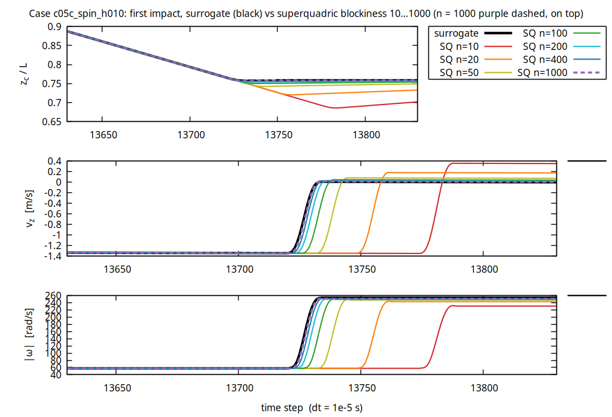
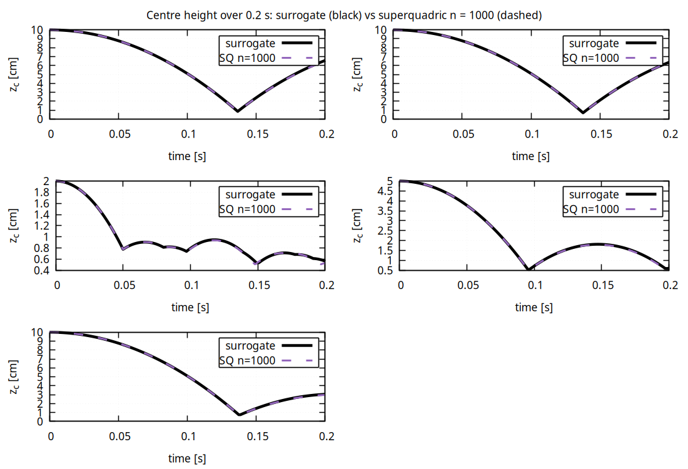
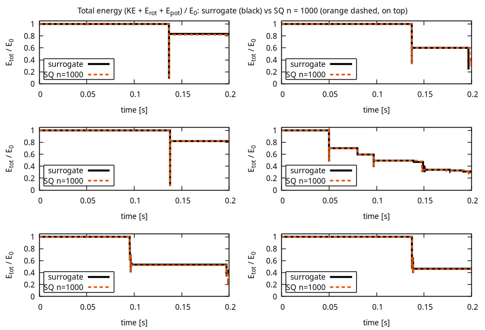
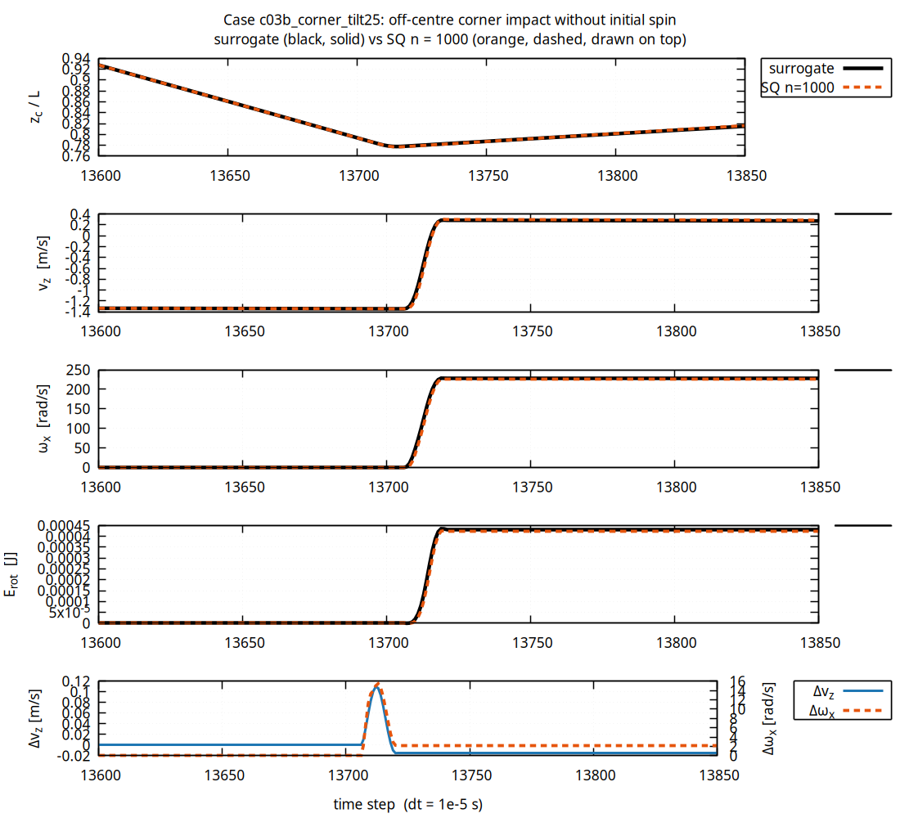
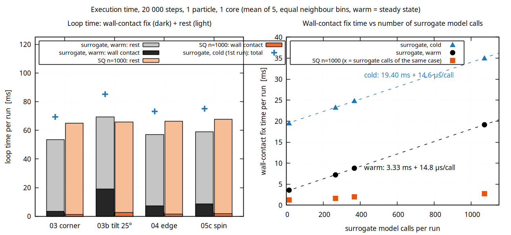
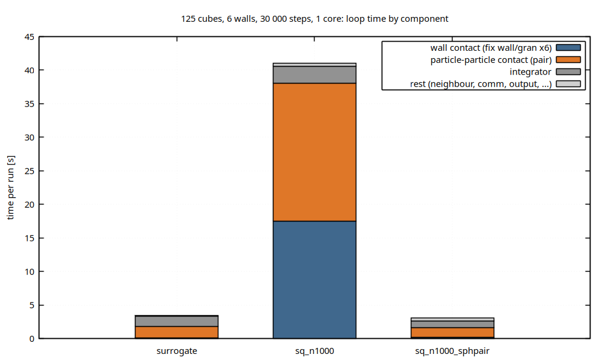

# Surrogate cube vs superquadric cube — wall-impact comparison

**Date:** 2026-11-18 (case 03b added the same day) · **Branch:** `surrogate-shape-dev` · **Status:** numerical verification
(no experimental validation) · Intended as input for a publication.

## 1. Purpose

Check the dynamics of the surrogate cube (ML-predicted overlap, `atom_style surrogate`, Spec 04)
against an independent native LIGGGHTS reference: the superquadric (SQ) particle, which can
represent a cube with rounded edges/corners. The SQ corner rounding shrinks with blockiness n,
so a sweep n = 10 … 1000 tests convergence of the reference to a sharp cube, which is what the
surrogate represents.

## 2. Method

**Common setup (all runs):** cube edge L = 0.01 m, ρ = 1000 kg/m³, Hertz normal + tangential
history (no rolling, no cohesion), E = 1e9 Pa, ν = 0.25, restitution 0.9, friction 0.2,
gravity 9.81 m/s², wall = plane z = 0, dt = 1e-5 s, 20 000 steps (0.2 s), single particle,
same initial position, orientation and spin in both models.

| Case | Initial orientation (q = qw qx qy qz) | ω₀ (rad/s) | centre height h₀ |
|---|---|---|---|
| 03 corner | body diagonal vertical: 0.8881 0.3251 −0.3251 0 | 0 | 0.10 m |
| 03b corner, tilted | case 03 then 25° about x: 0.7967 0.5096 −0.3174 −0.0704 | 0 | 0.10 m |
| 04 edge | 45° about x: 0.9239 0.3827 0 0 | 0 | 0.10 m |
| 05a spin | generic tilt (0.9, 0.3, 0.2, 0.1)/‖·‖ | (50, 30, 0) | 0.02 m |
| 05b spin | same | (50, 30, 0) | 0.05 m |
| 05c spin | same | (50, 30, 0) | 0.10 m |

**Surrogate:** inputs `test_cases/surrogate_contact/test_0{3,3b,4,5a,5b,5c}_*.in`; model run_029
(option4); contact point from the exact cube geometry (Spec 04 R04.2b STOPGAP); cube inertia
m L²/6; `surface surrogate`.

**Superquadric:** half-axes L/2, blockiness n₁ = n₂ = n ∈ {10, 20, 50, 100, 200, 400, 1000}
(case 03b: n = 1000 only),
mass and inertia from the SQ shape (density 1000), `fix nve/superquadric integration_scheme 1`,
`surface superquadric`. Inputs generated from
`test_cases/superquadric_reference/sq_05c_cube_1cm_spin_h010.in` with the case's height,
orientation, spin and n substituted. Built separately (`-DENABLE_SQ=ON`, see
`test_cases/superquadric_reference/README.md`).

SQ corner rounding (distance lost along the body diagonal relative to a sharp cube):
`δ_c / L = (√3/2)(1 − 3^(−1/n))` → 0.090 (n=10), 0.019 (n=50), 0.0095 (n=100), 0.00095 (n=1000);
SQ mass = 0.959 g (n=10) … 0.99999 g (n=1000) vs 1.000 g for the sharp cube.

**Output:** thermo every step (centre position, velocity, ω, KE, E_rot, E_pot, E_tot, F_z).
*Contact window* = consecutive steps in which E_tot changes (contact force active).
*First-impact metrics* use the state 2 steps before and 1 step after the first window.

**Note on the earlier "extrapolated" value.** Spec 04 (2026-11-18, first version) quoted a
"sharp-corner extrapolation" for case 05c. That was **post-processing** (a linear fit of
n = 10/20/50 to zero rounding), not a simulation. This report replaces it with **real runs** up
to n = 1000 (corner rounding 0.001 L) for all cases.

## 3. Results

### 3.1 First impact (table)

Data: [`data/first_impact_summary.dat`](data/first_impact_summary.dat) (all models, all cases);
deviations from the surrogate: [`data/deviation_vs_sq.dat`](data/deviation_vs_sq.dat).

| Case | Model | contact onset (step) | steps in contact | v_z before → after (m/s) | ‖ω‖ after (rad/s) | E loss in impact |
|---|---|---|---|---|---|---|
| 03 corner | surrogate | 13647 | 16 | −1.339 → +1.211 | 0 | 16.6 % |
|  | SQ n = 50 | 13661 | 16 | −1.340 → +1.207 | 0 | 17.2 % |
|  | SQ n = 1000 | 13647 | 17 | −1.339 → +1.200 | 0 | 17.9 % |
| 03b corner, tilted 25° | surrogate | 13707 | 15 | −1.344 → +0.285 | 227.49 | 39.9 % |
|  | SQ n = 1000 | 13708 | 14 | −1.345 → +0.300 | 225.23 | 40.1 % |
| 04 edge | surrogate | 13765 | 17 | −1.350 → +1.213 | 0 | 17.9 % |
|  | SQ n = 50 | 13772 | 16 | −1.351 → +1.217 | 0 | 17.5 % |
|  | SQ n = 1000 | 13765 | 17 | −1.350 → +1.212 | 0 | 18.1 % |
| 05a spin, 0.02 m | surrogate | 4990 | 16 | −0.489 → +0.158 | 89.01 | 29.8 % |
|  | SQ n = 50 | 5013 | 16 | −0.492 → +0.187 | 85.72 | 30.1 % |
|  | SQ n = 1000 | 4991 | 16 | −0.489 → +0.159 | 88.26 | 30.3 % |
| 05b spin, 0.05 m | surrogate | 9512 | 12 | −0.933 → −0.513 | 175.20 | 14.3 % |
|  | SQ n = 50 | 9518 | 12 | −0.934 → −0.457 | 180.91 | 16.3 % |
|  | SQ n = 1000 | 9512 | 12 | −0.933 → −0.511 | 174.88 | 14.6 % |
| 05c spin, 0.10 m | surrogate | 13721 | 14 | −1.346 → +0.006 | 253.16 | 36.5 % |
|  | SQ n = 50 | 13733 | 14 | −1.347 → +0.079 | 247.90 | 38.1 % |
|  | SQ n = 1000 | 13722 | 14 | −1.346 → +0.014 | 250.06 | 37.6 % |

(In 05b the first contact is a glancing corner hit that does not reverse v_z; the cube keeps
falling and hits again at step ≈ 9537 — identical in both models, see `data/ts_c05b_*`.)

**Deviation SQ n = 1000 vs surrogate at first impact:**

| Case | Δ onset (steps) | |Δv_z| after (m/s) | ‖Δω‖ / ‖ω_surr‖ |
|---|---|---|---|
| 03 corner | 0 | 0.010 | — (no spin) |
| 03b corner, tilted | 1 | 0.015 | 1.0 % |
| 04 edge | 0 | 0.001 | — (no spin) |
| 05a | 1 | 0.001 | 0.9 % |
| 05b | 0 | 0.002 | 0.2 % |
| 05c | 1 | 0.008 | 1.2 % |

### 3.2 Convergence with corner sharpness — Figure 1


**Figure 1** — `plots/fig01_convergence_first_impact.png` (script
`plots/fig01_convergence_first_impact.gp`). Left: |v_z(SQ) − v_z(surrogate)| after the first
impact vs SQ corner rounding δ_c/L (log–log), all cases. Right: relative ω deviation, spinning
cases. **Data:** `data/deviation_vs_sq.dat`, one gnuplot index (block) per case in the order
03, 03b (n = 1000 only), 04, 05a, 05b, 05c; columns `case blockiness corner_round_L |dvz_post| |dw_post| rel_dw |d_onset|`.

Observations:
- The contact onset step converges to the surrogate's exactly (Δ = 0 or 1 step at n = 1000);
  for n = 10 it is 35–116 steps late, as expected from rounded corners.
- For the spinning cases the post-impact v_z deviation decreases roughly linearly with δ_c
  (≈ 1.5–6 m/s per unit δ_c/L) down to ≈ 0.001–0.008 m/s at n = 1000.
- The relative ω deviation decreases from 10–45 % (n = 10) to ≈ 1 % (n ≥ 200) and then
  plateaus at 0.2–1.2 %. The plateau is consistent with the remaining model differences
  (Section 4), not with a trend.
- Non-spinning corner/edge cases agree within 0.001–0.010 m/s for all n: symmetric contacts
  are insensitive to rounding (no lever arm).

### 3.3 First-impact time series — Figures 3a–3e

| Figure | File | Data |
|---|---|---|
| 3a corner | `plots/fig_c03_corner_first_impact.png` | `data/ts_c03_corner_*.dat` |
| 3a′ corner tilted 25° | `plots/fig_c03b_corner_tilt25_first_impact.png` | `data/ts_c03b_corner_tilt25_{surrogate,sq_n1000}.dat` |
| 3b edge | `plots/fig_c04_edge_first_impact.png` | `data/ts_c04_edge_*.dat` |
| 3c spin 0.02 m | `plots/fig_c05a_spin_h002_first_impact.png` | `data/ts_c05a_spin_h002_*.dat` |
| 3d spin 0.05 m | `plots/fig_c05b_spin_h005_first_impact.png` | `data/ts_c05b_spin_h005_*.dat` |
| 3e spin 0.10 m | `plots/fig_c05c_spin_h010_first_impact.png` | `data/ts_c05c_spin_h010_*.dat` |



**Figure 3e (example)** — centre height z_c/L, v_z and ‖ω‖ around the first impact of case 05c;
surrogate in black (drawn first), SQ n = 10 … 1000 coloured on top (n = 1000 purple dashed). The SQ curves move toward the
surrogate as n grows; n = 1000 is close to the surrogate in all three panels.

**Time-series data files** `data/ts_<case>_<model>.dat`, `<model>` ∈ {surrogate, sq_n10, …, sq_n1000}.
Columns: `step time_s xc_m yc_m zc_m vx vy vz wx wy wz ke_J erot_J epot_J etot_J fz_N`
(SI units; E_rot for the surrogate with I = m L²/6, for SQ from the SQ inertia tensor).
Sampling: every step within ±200 steps of any contact, every 10th step elsewhere.

### 3.4 Full trajectories — Figure 2



**Figure 2** — `plots/fig02_trajectories_full.png`: centre height over 0.2 s, surrogate (black)
vs SQ n = 1000 (orange dashed, on top), all cases. **Data:** `data/ts_<case>_surrogate.dat`, `data/ts_<case>_sq_n1000.dat`
(column 2 time, column 5 z_c).

- Maximum |Δz_c| over the whole run: 0.007 L (edge), 0.05–0.08 L (corner and spinning cases).
- For 05b the impact sequence matches impact by impact (steps 9512/9537/9618/9701 vs
  9512/9538/9618/9702); the trajectories start to separate after the 4th impact and differ at
  the 5th–6th impacts (≈ step 19 700), where the energies differ (2.07e-4 vs 1.42e-4 J).
  Tumbling impacts are sensitive to small differences in the post-impact state (orientation
  at the next contact), so late-time divergence is expected and is not, by itself, a
  discrepancy of the contact model.

### 3.5 Energy — Figure 4



**Figure 4** — `plots/fig03_energy.png`: E_tot / E₀ = (KE + E_rot + E_pot)/E₀ vs time,
surrogate (black) vs SQ n = 1000 (orange dashed, on top). **Data:** column 15 of `data/ts_<case>_*.dat`.

- In every run (40 runs) `max(E_tot)/E₀ = 1.00000000` (column `max_etot_over_E0` of
  `first_impact_summary.dat`): energy never increases; it drops only during contacts
  (damping, friction).
- Energy at t = 0.2 s, surrogate vs SQ n = 1000: 0.834 vs 0.821 (corner), 0.411 vs 0.416 (corner tilted), 0.821 vs 0.819
  (edge), 0.312 vs 0.280 (05a), 0.398 vs 0.274 (05b, late divergence), 0.465 vs 0.458 (05c).

### 3.6 Off-centre corner impact without initial spin (case 03b) — Figure 5

**Question:** a cube that lands on a corner which is *not* directly below its centre should be
set spinning by the impact (the normal force has a lever arm), even with zero initial spin.
Case 03 (body diagonal vertical) has zero lever arm; case 03b tilts it by 25° about x, so a
single corner still touches first, but 0.366 L sideways of the centre (2nd vertex 0.28 L higher).



**Figure 5** — `plots/fig_c03b_corner_tilt25_first_impact.png`: z_c/L, v_z, ω_x and E_rot
around the first impact, surrogate (black, solid) vs SQ n = 1000 (orange dashed, drawn on top
so that it stays visible where the two curves coincide), plus a bottom panel with the
differences Δv_z (left axis) and Δω_x (right axis), surrogate − SQ. **Data:**
`data/ts_c03b_corner_tilt25_surrogate.dat`, `data/ts_c03b_corner_tilt25_sq_n1000.dat`
(columns as in Section 3.3; ω_x = column 9, E_rot = column 13; the difference panel joins the
two files on the step column).

The curves overlap almost everywhere (Δv_z ≤ 0.1 m/s and Δω_x ≤ 16 rad/s only during the
~15 contact steps, then 0.015 m/s and 2.3 rad/s after the impact), which is why the reference
curve must be drawn on top.

**Result: the impact spins the cube, as expected.**

| | surrogate | SQ n = 1000 | difference |
|---|---|---|---|
| contact onset (step) | 13707 | 13708 | 1 step |
| v_z before → after (m/s) | −1.344 → +0.285 | −1.345 → +0.300 | 0.015 m/s |
| ω after impact (rad/s) | (227.49, 0.00, 0.00) | (225.23, 0.04, 0.00) | 1.0 % |
| E_rot after impact (J) | 4.31e-4 | 4.23e-4 | 2.0 % |
| energy loss in the impact | 39.9 % | 40.1 % | — |
| max(E_tot)/E₀ over the run | 1.0 | 1.0 | — |

- The spin axis is x — the tilt axis — and both models agree on it; by symmetry no y/z spin
  appears (surrogate 7e-13 rad/s, SQ 0.04 rad/s).
- Compared with case 03 (same drop, no tilt: rebound v_z = +1.211 m/s, ω = 0), about half of
  the pre-impact kinetic energy is converted into rotation (E_rot ≈ 48 % (surrogate) / 47 % (SQ)
  of the pre-impact KE) and the
  rebound speed drops from 1.21 to 0.29 m/s.
- This is the behaviour that requires the contact point (lever arm) of Spec 04 R04.2b; before
  the stopgap the surrogate would have produced ω = 0 here.

### 3.7 Execution performance — Figure 6

**Setup.** Four cases (03 corner, 03b corner tilted 25°, 04 edge, 05c spinning), surrogate vs
SQ n = 1000, same inputs as above but thermo every 1000 steps and no dumps; 20 000 steps,
1 particle; 1 core (`taskset -c 2`), `OMP_NUM_THREADS=1`, Release `-O3`, Intel i9-14900K;
5 repeats each. Times are LIGGGHTS' own timers (`modify_timing verbose`). Each process runs the
case **twice** (`run`, reset particle, `run`): run 1 = *cold* (includes the LibTorch first-call
warm-up), run 2 = identical *warm* re-run in the same process (steady state, what a long
simulation sees). Both models use `neigh_modify binsize 0.0092` (see note 1 below).



**Figure 6** — `plots/fig06_execution_time.png` (script `plots/fig06_execution_time.gp`).
Left: loop time per run, split into the wall-contact fix (`fix wall/gran`: contact geometry +
contact law; dark) and the rest (light); warm surrogate (grey/black), SQ (orange), cold surrogate
total (blue cross). Right: wall-contact fix time vs number of surrogate model calls per run, with
linear fits. **Data:** `data/timing_plot.dat` (columns `idx case calls S_loop_w S_wall_w S_rest_w
Q_loop_w Q_wall_w Q_rest_w S_loop_c S_wall_c Q_loop_c Q_wall_c S_wall_per_call_us_w`, ms);
full breakdown per run with std-devs: `data/timing_summary.dat` (block 0 = cold, block 1 = warm;
columns documented in the header); raw per-repeat timings: `data/timing_raw_warm.dat`
(and `data/timing_raw_default_bins.dat` for note 1).

**Wall-contact fix (the part that differs), warm, ms per 20 000 steps:**

| Case | surrogate model calls | surrogate | SQ n = 1000 | ratio |
|---|---|---|---|---|
| 03 corner | 15 | 3.55 | 1.27 | 2.8× |
| 03b corner tilted | 1071 | 19.17 | 2.78 | 6.9× |
| 04 edge | 265 | 7.23 | 1.58 | 4.6× |
| 05c spin | 367 | 8.77 | 1.98 | 4.4× |

- Surrogate wall-fix cost ≈ **3.3 ms + 14.8 µs per model call** (fit, R² ≈ 1). The 14.8 µs is
  one LibTorch forward pass of the 128-64-32-16 network (batch 1, float32, CPU); a standalone
  micro-benchmark gives 14.1 µs per call, of which the exact analytic part (h_exact + contact
  point) is only 0.03 µs. The SQ contact evaluation costs ≈ 1.5–2 µs per contact step.
  → **Per contact evaluation the superquadric is ≈ 7–10× faster than the surrogate.**
- Cold runs add a constant **≈ 16 ms** (LibTorch first-call warm-up: 22 ms + 1.8 ms for the
  first two calls in the micro-benchmark), i.e. cold wall-fix ≈ 19.4 ms + 14.6 µs/call.

**Whole simulation loop, warm, ms per 20 000 steps (mean ± std of 5):**

| Case | surrogate | SQ n = 1000 | ratio SQ/surrogate |
|---|---|---|---|
| 03 corner | 53.4 ± 0.2 | 65.0 ± 4.5 | 1.22 |
| 03b corner tilted | 69.5 ± 0.2 | 65.7 ± 0.5 | 0.95 |
| 04 edge | 57.1 ± 0.2 | 66.4 ± 6.3 | 1.16 |
| 05c spin | 58.9 ± 0.2 | 67.6 ± 6.0 | 1.15 |

- In these single-particle runs the total is dominated by neighbour-list rebuilds (~42 ms,
  `check no delay 0` → rebuild every step, identical for both). The SQ run carries ~10 ms of
  `fix contacthistory` (pair-history bookkeeping of the superquadric surface model) and a more
  expensive integrator (2.9–3.7 vs 1.2–1.5 ms); the surrogate carries the model calls. Net:
  the surrogate is 15–22 % faster overall when contacts are short (03, 04, 05c) and 5 % slower
  when the particle stays in contact for long (03b: 1071 calls).
- **Expectation "SQ faster" is confirmed for the contact computation itself** (7–10× per
  evaluation), **not for the whole run** in this single-particle test, because the contact is
  a small fraction of the total and SQ has other fixed overheads.

**Notes.**
1. *Neighbour bins.* With LIGGGHTS' default bin size (0.5·cutneighmax), the surrogate's
   neighbour radius L/2 gives ~5× more (empty) bins than the SQ bounding radius 0.866·L, which
   made the surrogate's neighbour build ≈ 150 ms vs 42 ms (loop 178–205 ms vs 63–65 ms,
   `data/timing_raw_default_bins.dat`). This is a bookkeeping artefact of a large empty box with
   one particle, not contact cost, so the comparison above fixes both to the same bin size.
   **Fixed 2026-11-18** (Spec 03 R03.11): surrogate `radius` is now the bounding radius
   0.866·L; with default settings the surrogate neighbour time is 43 ms per run, equal to SQ
   (loop 70–86 ms), results unchanged (ctest regression).
2. *Scaling with particle count.* The model cost is per wall contact. **Implemented 2026-11-18**
   (Spec 04 R04.2f): all contacts of a step and wall go through one forward pass; per particle
   the cost falls to ~0.4 µs at batch ≥ 100. In a 125-cube test (Spec 06) the wall-contact time
   dropped 11× (17.3 s → 1.57 s for 30 000 steps). The single-particle timings above are
   unaffected (batch of 1).
3. *Variance.* SQ runs show occasional slow repeats (std up to 6 ms); surrogate runs are
   stable (≤ 0.2 ms). The machine was shared (load ≈ 3.5 on 32 cores); runs were sequential and
   pinned to one core.

### 3.8 Execution performance, 125 particles — Figure 7

**Purpose.** Performance only; results (trajectories, packing) are **not** compared here.
**Setup.** Multi-particle case of Spec 06: 125 cubes (L = 1 cm, random orientations, same seeds),
closed box of 6 primitive walls, 30 000 steps, dt = 1e-5 s, no dumps, `modify_timing verbose`;
serial runs pinned to one core, `OMP_NUM_THREADS=1`, 3 repeats (std ≤ 0.012 s); same machine
as 3.7. Inputs: `test_cases/surrogate_multi/in.pour_125_cubes` (surrogate, batched model calls,
Spec 04 R04.2f) and `test_cases/superquadric_reference/sq_pour_125_cubes.in` (SQ n = 1000).
Script: `scripts/run_perf_125.sh`.

Cube–cube contact is **not the same** in the two inputs: the surrogate has no cube–cube model yet
and uses a sphere PLACEHOLDER (bounding radius, `surface default`, Spec 04 R04.7), while the SQ
input uses the real superquadric shape contact. A third run, *SQ n = 1000 + sphere pair*, uses
the same placeholder on the SQ side so that wall contact and integration can be compared with
identical pair treatment.



**Figure 7** — `plots/fig07_execution_time_125cubes.png` (script
`plots/fig07_execution_time_125cubes.gp`): serial loop time per run, stacked by component.
**Data:** `data/timing_125cubes.dat` (means), raw: `data/timing_raw_125cubes.dat`
(columns `variant np rep loop pair neigh comm wall integrate`, s).

**Serial, s per 30 000 steps (mean of 3):**

| Variant | loop | wall contact (6 fixes) | pair (cube–cube) | integrator | rest |
|---|---|---|---|---|---|
| surrogate (batched) + sphere pair | **1.73** | 1.58 | 0.06 | 0.06 | 0.03 |
| SQ n = 1000 + SQ pair (real shape contact) | **20.51** | 2.53 | 17.52 | 0.44 | 0.03 |
| SQ n = 1000 + sphere pair (same placeholder) | **1.52** | 0.99 | 0.14 | 0.37 | 0.02 |
| *surrogate, unbatched (before R04.2f)* | *17.47* | *17.32* | – | – | – |

- **Wall contact:** batched surrogate 1.58 s vs SQ 0.99–2.53 s, i.e. the same order. The SQ value
  depends on how many wall contacts occur, and that number differs between the runs because the
  trajectories differ (different pair model, different dynamics). Contacts were not counted, so
  no per-contact cost is given here. Without batching the surrogate needed 17.3 s (≈ 7–17× SQ),
  so batching is what makes the surrogate competitive with many particles.
- **Particle–particle contact dominates the real SQ run:** 17.5 s of 20.5 s (85 %) is
  superquadric cube–cube contact. The surrogate run does not have this cost yet; its 0.06 s is the
  sphere placeholder. **The total-loop comparison (1.73 vs 20.51 s) is therefore not a fair
  surrogate-vs-SQ result** — it will change once a cube–cube surrogate exists (Spec 04 R04.7),
  whose cost per pair contact is still unknown.
- **Integrator:** surrogate `nve/sphere` with isotropic inertia 0.06 s vs `nve/superquadric`
  0.37–0.44 s (full inertia tensor, symplectic scheme), ≈ 6–7×.
- With the same placeholder pair on both sides, the totals are close: surrogate 1.73 s vs SQ 1.52 s
  (surrogate 13 % slower; the wall-contact time is higher, the integrator cheaper).

**MPI (1 repeat each, loop time, s):**

| ranks (grid) | surrogate | SQ n = 1000 + SQ pair |
|---|---|---|
| 1 | 1.72 | 20.51 |
| 2 (1×1×2) | 1.75 | 20.49 |
| 4 (1×2×2) | 1.42 | 12.69 |

- 2 ranks give no speed-up for **either** model: the domain is cut in z, and after the cubes
  settle all of them are in the lower half, so one rank does all the work (load imbalance, not a
  surrogate effect). 4 ranks also split in y: 1.2× (surrogate), 1.6× (SQ). Better scaling would
  need `balance`/`fix balance` or more particles; not part of this test.

## 4. Discussion

Remaining differences between the sharp surrogate cube and the n = 1000 superquadric are
expected from model differences, not from the surrogate geometry:

1. **Effective radius in Hertz.** The surrogate passes `reff = L/2` (inscribed sphere); the
   superquadric computes a curvature-based effective radius at the contact point. Hertz
   stiffness ∝ √reff, so normal forces at a corner differ slightly. This is a physics-model
   choice (corner contact of a sharp body has no unique Hertz radius) and should be stated in
   a publication.
2. **Contact point definition.** Surrogate (stopgap): penetration-weighted mean of penetrating
   vertices, projected on the wall. SQ: point of maximal penetration from the SQ surface. They
   coincide for a single corner; they differ for near-edge/near-face contacts.
3. **Mass and inertia.** SQ n = 1000 mass is 0.99999 of the sharp cube; inertia slightly lower.
   Negligible at n = 1000, relevant at n ≤ 50.
4. **Integrators.** Surrogate: isotropic-inertia quaternion update in `fix nve/sphere`; SQ:
   symplectic `nve/superquadric` scheme 1 with the full inertia tensor. Equivalent for a cube
   (isotropic inertia), different round-off.
5. **Surrogate accuracy.** run_029 predicts the signed distance with ≈ 6e-5 L MAE, i.e. a
   ~0.1–1 % error on the ~0.007 L penetrations seen here.

## 5. Conclusions

- With real runs up to blockiness 1000, the superquadric reference converges to the surrogate
  for all six cases: contact onset within 1 step, rebound v_z within 0.001–0.015 m/s,
  post-impact spin within 0.2–1.2 %.
- An off-centre corner impact without initial spin (case 03b) spins the cube about the tilt
  axis (227 vs 225 rad/s, surrogate vs SQ n = 1000).
- Symmetric corner/edge impacts give no spurious spin in either model; restitution ≈ 0.90.
- Energy is never created in any run.
- The surrogate's contact geometry (overlap from the ML model, contact point from the exact
  cube geometry, stopgap) therefore reproduces native superquadric contact dynamics for a
  sharp cube, at L = 1 cm.
- Performance: per contact evaluation the superquadric is ≈ 7–10× faster (≈ 1.5–2 µs vs
  14.8 µs per LibTorch forward pass, plus a one-off ≈ 16 ms warm-up); in single-particle runs the
  total loop time is similar (surrogate 15–22 % faster for short contacts, 5 % slower for a long
  contact) because neighbour bookkeeping dominates.
- Performance with 125 particles (3.8): with batched model calls the surrogate wall contact is of
  the same order as SQ (1.6 s vs 1.0–2.5 s per 30 000 steps; unbatched it was 17.3 s). Whole-run
  times (1.7 s vs 20.5 s) are not yet comparable: 85 % of the SQ run is superquadric cube–cube
  contact, which the surrogate replaces by a sphere placeholder until a cube–cube surrogate exists.
- Limits: numerical comparison only, single size (L = 1 cm), one material, wall contacts only
  (cube–cube only as a sphere placeholder in 3.8),
  contact point still from the LIGGGHTS stopgap (Spec 04 R04.2b), no experiments.

## 6. Reproduction

```bash
# surrogate build: build/ (ENABLE_SURROGATE=ON); SQ build from a copy of src/ (see
# test_cases/superquadric_reference/README.md). Runs: 5 cases × (surrogate + 7 SQ n) + case 03b × (surrogate + SQ n=1000),
# thermo every step, 20 000 steps; then:
cd DOCUMENTATION.md/comparison_surrogate_vs_superquadric/plots
for f in fig*.gp; do gnuplot "$f"; done
```
125-cube performance (3.8): `scripts/run_perf_125.sh > data/timing_raw_125cubes.dat`
(≈ 3 min), then the means in `data/timing_125cubes.dat` and `gnuplot fig07_execution_time_125cubes.gp`.

Scripts used to generate the runs and data (kept for reference): `scripts/` in this folder
(`make_sq.py` inputs, `make_runs.py`/`make_runs2.py` per-step thermo, `run1.sh` one run,
`extract.py` → `first_impact_summary.dat` + time series, `dev.py` → `deviation_vs_sq.dat`,
`thin.py` sampling). They contain absolute paths of the original machine (`/tmp/opencode/cmpw`,
repo path); adapt before reuse.

## 7. Files

| Path | Content |
|---|---|
| `data/first_impact_summary.dat` | first-impact metrics, all cases × models (header documents columns) |
| `data/deviation_vs_sq.dat` | SQ − surrogate deviations vs blockiness (one block per case) |
| `data/ts_<case>_<model>.dat` | time series (42 files) |
| `plots/common.gp` | shared gnuplot settings (run scripts from `plots/`) |
| `plots/fig01_convergence_first_impact.{gp,png}` | Figure 1 |
| `plots/fig02_trajectories_full.{gp,png}` | Figure 2 |
| `plots/fig03_energy.{gp,png}` | Figure 4 |
| `plots/fig_<case>_first_impact.{gp,png}` | Figures 3a–3e |
| `plots/fig_c03b_corner_tilt25_first_impact.{gp,png}` | Figure 5 (case 03b) |
| `plots/fig06_execution_time.{gp,png}` | Figure 6 (performance) |
| `data/timing_summary.dat`, `data/timing_plot.dat` | timing breakdown (cold/warm), plot table |
| `data/timing_raw_warm.dat`, `data/timing_raw_default_bins.dat` | raw per-repeat timings |
| `scripts/run_perf.sh`, `scripts/run_warm.sh`, `scripts/bench_torch_call.cpp` | timing scripts, LibTorch micro-benchmark |
| `plots/fig07_execution_time_125cubes.{gp,png}` | Figure 7 (performance, 125 cubes) |
| `data/timing_125cubes.dat`, `data/timing_raw_125cubes.dat` | 125-cube timings (mean, raw incl. MPI) |
| `scripts/run_perf_125.sh` | 125-cube timing runs (surrogate, SQ, SQ + sphere pair; np 1/2/4) |
| `scripts/` | Python scripts that generated inputs, runs and data |
