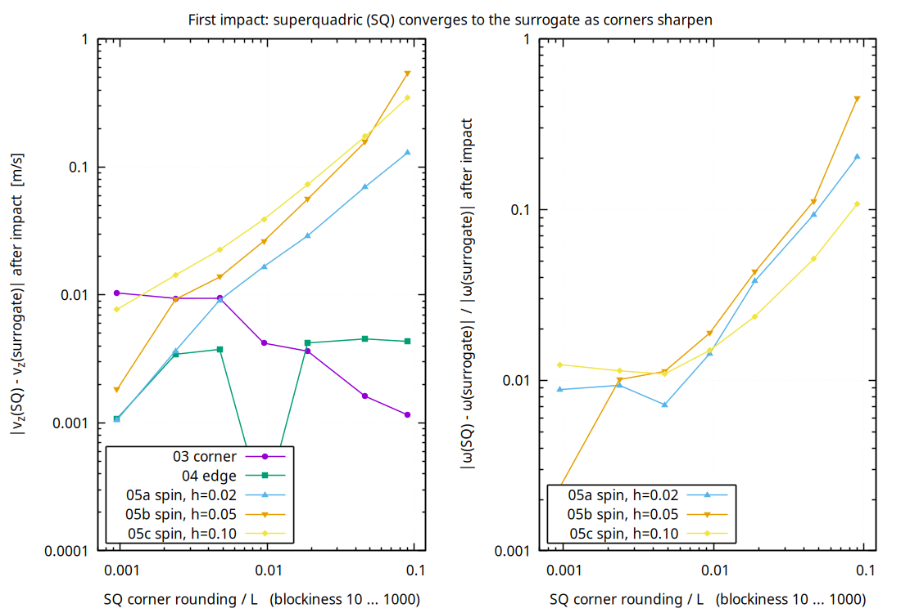

# Surrogate cube vs superquadric cube — wall-impact comparison

**Date:** 2026-11-18 · **Branch:** `surrogate-shape-dev` · **Status:** numerical verification
(no experimental validation) · Intended as input for a publication.

## 1. Purpose

Check the dynamics of the surrogate cube (ML-predicted overlap, `atom_style surrogate`, Spec 04)
against an independent native LIGGGHTS reference: the superquadric (SQ) particle, which can
represent a cube with rounded edges/corners. The SQ corner rounding shrinks with blockiness n,
so a sweep n = 10 … 1000 tests convergence of the reference to a sharp cube, which is what the
surrogate represents.

## 2. Method

**Common setup (all runs):** cube edge L = 0.01 m, ρ = 1000 kg/m³, Hertz normal + tangential
history (no rolling, no cohesion), E = 1e9 Pa, ν = 0.25, restitution 0.9, friction 0.2,
gravity 9.81 m/s², wall = plane z = 0, dt = 1e-5 s, 20 000 steps (0.2 s), single particle,
same initial position, orientation and spin in both models.

| Case | Initial orientation (q = qw qx qy qz) | ω₀ (rad/s) | centre height h₀ |
|---|---|---|---|
| 03 corner | body diagonal vertical: 0.8881 0.3251 −0.3251 0 | 0 | 0.10 m |
| 04 edge | 45° about x: 0.9239 0.3827 0 0 | 0 | 0.10 m |
| 05a spin | generic tilt (0.9, 0.3, 0.2, 0.1)/‖·‖ | (50, 30, 0) | 0.02 m |
| 05b spin | same | (50, 30, 0) | 0.05 m |
| 05c spin | same | (50, 30, 0) | 0.10 m |

**Surrogate:** inputs `test_cases/surrogate_contact/test_0{3,4,5a,5b,5c}_*.in`; model run_029
(option4); contact point from the exact cube geometry (Spec 04 R04.2b STOPGAP); cube inertia
m L²/6; `surface surrogate`.

**Superquadric:** half-axes L/2, blockiness n₁ = n₂ = n ∈ {10, 20, 50, 100, 200, 400, 1000},
mass and inertia from the SQ shape (density 1000), `fix nve/superquadric integration_scheme 1`,
`surface superquadric`. Inputs generated from
`test_cases/superquadric_reference/sq_05c_cube_1cm_spin_h010.in` with the case's height,
orientation, spin and n substituted. Built separately (`-DENABLE_SQ=ON`, see
`test_cases/superquadric_reference/README.md`).

SQ corner rounding (distance lost along the body diagonal relative to a sharp cube):
`δ_c / L = (√3/2)(1 − 3^(−1/n))` → 0.090 (n=10), 0.019 (n=50), 0.0095 (n=100), 0.00095 (n=1000);
SQ mass = 0.959 g (n=10) … 0.99999 g (n=1000) vs 1.000 g for the sharp cube.

**Output:** thermo every step (centre position, velocity, ω, KE, E_rot, E_pot, E_tot, F_z).
*Contact window* = consecutive steps in which E_tot changes (contact force active).
*First-impact metrics* use the state 2 steps before and 1 step after the first window.

**Note on the earlier "extrapolated" value.** Spec 04 (2026-11-18, first version) quoted a
"sharp-corner extrapolation" for case 05c. That was **post-processing** (a linear fit of
n = 10/20/50 to zero rounding), not a simulation. This report replaces it with **real runs** up
to n = 1000 (corner rounding 0.001 L) for all five cases.

## 3. Results

### 3.1 First impact (table)

Data: [`data/first_impact_summary.dat`](data/first_impact_summary.dat) (all models, all cases);
deviations from the surrogate: [`data/deviation_vs_sq.dat`](data/deviation_vs_sq.dat).

| Case | Model | contact onset (step) | steps in contact | v_z before → after (m/s) | ‖ω‖ after (rad/s) | E loss in impact |
|---|---|---|---|---|---|---|
| 03 corner | surrogate | 13647 | 16 | −1.339 → +1.211 | 0 | 16.6 % |
|  | SQ n = 50 | 13661 | 16 | −1.340 → +1.207 | 0 | 17.2 % |
|  | SQ n = 1000 | 13647 | 17 | −1.339 → +1.200 | 0 | 17.9 % |
| 04 edge | surrogate | 13765 | 17 | −1.350 → +1.213 | 0 | 17.9 % |
|  | SQ n = 50 | 13772 | 16 | −1.351 → +1.217 | 0 | 17.5 % |
|  | SQ n = 1000 | 13765 | 17 | −1.350 → +1.212 | 0 | 18.1 % |
| 05a spin, 0.02 m | surrogate | 4990 | 16 | −0.489 → +0.158 | 89.01 | 29.8 % |
|  | SQ n = 50 | 5013 | 16 | −0.492 → +0.187 | 85.72 | 30.1 % |
|  | SQ n = 1000 | 4991 | 16 | −0.489 → +0.159 | 88.26 | 30.3 % |
| 05b spin, 0.05 m | surrogate | 9512 | 12 | −0.933 → −0.513 | 175.20 | 14.3 % |
|  | SQ n = 50 | 9518 | 12 | −0.934 → −0.457 | 180.91 | 16.3 % |
|  | SQ n = 1000 | 9512 | 12 | −0.933 → −0.511 | 174.88 | 14.6 % |
| 05c spin, 0.10 m | surrogate | 13721 | 14 | −1.346 → +0.006 | 253.16 | 36.5 % |
|  | SQ n = 50 | 13733 | 14 | −1.347 → +0.079 | 247.90 | 38.1 % |
|  | SQ n = 1000 | 13722 | 14 | −1.346 → +0.014 | 250.06 | 37.6 % |

(In 05b the first contact is a glancing corner hit that does not reverse v_z; the cube keeps
falling and hits again at step ≈ 9537 — identical in both models, see `data/ts_c05b_*`.)

**Deviation SQ n = 1000 vs surrogate at first impact:**

| Case | Δ onset (steps) | |Δv_z| after (m/s) | ‖Δω‖ / ‖ω_surr‖ |
|---|---|---|---|
| 03 corner | 0 | 0.010 | — (no spin) |
| 04 edge | 0 | 0.001 | — (no spin) |
| 05a | 1 | 0.001 | 0.9 % |
| 05b | 0 | 0.002 | 0.2 % |
| 05c | 1 | 0.008 | 1.2 % |

### 3.2 Convergence with corner sharpness — Figure 1



**Figure 1** — `plots/fig01_convergence_first_impact.png` (script
`plots/fig01_convergence_first_impact.gp`). Left: |v_z(SQ) − v_z(surrogate)| after the first
impact vs SQ corner rounding δ_c/L (log–log), all cases. Right: relative ω deviation, spinning
cases. **Data:** `data/deviation_vs_sq.dat`, one gnuplot index (block) per case in the order
03, 04, 05a, 05b, 05c; columns `case blockiness corner_round_L |dvz_post| |dw_post| rel_dw |d_onset|`.

Observations:
- The contact onset step converges to the surrogate's exactly (Δ = 0 or 1 step at n = 1000);
  for n = 10 it is 35–116 steps late, as expected from rounded corners.
- For the spinning cases the post-impact v_z deviation decreases roughly linearly with δ_c
  (≈ 1.5–6 m/s per unit δ_c/L) down to ≈ 0.001–0.008 m/s at n = 1000.
- The relative ω deviation decreases from 10–45 % (n = 10) to ≈ 1 % (n ≥ 200) and then
  plateaus at 0.2–1.2 %. The plateau is consistent with the remaining model differences
  (Section 4), not with a trend.
- Non-spinning corner/edge cases agree within 0.001–0.010 m/s for all n: symmetric contacts
  are insensitive to rounding (no lever arm).

### 3.3 First-impact time series — Figures 3a–3e

| Figure | File | Data |
|---|---|---|
| 3a corner | `plots/fig_c03_corner_first_impact.png` | `data/ts_c03_corner_*.dat` |
| 3b edge | `plots/fig_c04_edge_first_impact.png` | `data/ts_c04_edge_*.dat` |
| 3c spin 0.02 m | `plots/fig_c05a_spin_h002_first_impact.png` | `data/ts_c05a_spin_h002_*.dat` |
| 3d spin 0.05 m | `plots/fig_c05b_spin_h005_first_impact.png` | `data/ts_c05b_spin_h005_*.dat` |
| 3e spin 0.10 m | `plots/fig_c05c_spin_h010_first_impact.png` | `data/ts_c05c_spin_h010_*.dat` |


**Figure 3e (example)** — centre height z_c/L, v_z and ‖ω‖ around the first impact of case 05c;
surrogate in black, SQ n = 10 … 1000 coloured (n = 1000 dashed). The SQ curves move toward the
surrogate as n grows; n = 1000 is close to the surrogate in all three panels.

**Time-series data files** `data/ts_<case>_<model>.dat`, `<model>` ∈ {surrogate, sq_n10, …, sq_n1000}.
Columns: `step time_s xc_m yc_m zc_m vx vy vz wx wy wz ke_J erot_J epot_J etot_J fz_N`
(SI units; E_rot for the surrogate with I = m L²/6, for SQ from the SQ inertia tensor).
Sampling: every step within ±200 steps of any contact, every 10th step elsewhere.

### 3.4 Full trajectories — Figure 2


**Figure 2** — `plots/fig02_trajectories_full.png`: centre height over 0.2 s, surrogate vs SQ
n = 1000, all cases. **Data:** `data/ts_<case>_surrogate.dat`, `data/ts_<case>_sq_n1000.dat`
(column 2 time, column 5 z_c).

- Maximum |Δz_c| over the whole run: 0.007 L (edge), 0.05–0.08 L (corner and spinning cases).
- For 05b the impact sequence matches impact by impact (steps 9512/9537/9618/9701 vs
  9512/9538/9618/9702); the trajectories start to separate after the 4th impact and differ at
  the 5th–6th impacts (≈ step 19 700), where the energies differ (2.07e-4 vs 1.42e-4 J).
  Tumbling impacts are sensitive to small differences in the post-impact state (orientation
  at the next contact), so late-time divergence is expected and is not, by itself, a
  discrepancy of the contact model.

### 3.5 Energy — Figure 4


**Figure 4** — `plots/fig03_energy.png`: E_tot / E₀ = (KE + E_rot + E_pot)/E₀ vs time,
surrogate vs SQ n = 1000. **Data:** column 15 of `data/ts_<case>_*.dat`.

- In every run (40 runs) `max(E_tot)/E₀ = 1.00000000` (column `max_etot_over_E0` of
  `first_impact_summary.dat`): energy never increases; it drops only during contacts
  (damping, friction).
- Energy at t = 0.2 s, surrogate vs SQ n = 1000: 0.834 vs 0.821 (corner), 0.821 vs 0.819
  (edge), 0.312 vs 0.280 (05a), 0.398 vs 0.274 (05b, late divergence), 0.465 vs 0.458 (05c).

## 4. Discussion

Remaining differences between the sharp surrogate cube and the n = 1000 superquadric are
expected from model differences, not from the surrogate geometry:

1. **Effective radius in Hertz.** The surrogate passes `reff = L/2` (inscribed sphere); the
   superquadric computes a curvature-based effective radius at the contact point. Hertz
   stiffness ∝ √reff, so normal forces at a corner differ slightly. This is a physics-model
   choice (corner contact of a sharp body has no unique Hertz radius) and should be stated in
   a publication.
2. **Contact point definition.** Surrogate (stopgap): penetration-weighted mean of penetrating
   vertices, projected on the wall. SQ: point of maximal penetration from the SQ surface. They
   coincide for a single corner; they differ for near-edge/near-face contacts.
3. **Mass and inertia.** SQ n = 1000 mass is 0.99999 of the sharp cube; inertia slightly lower.
   Negligible at n = 1000, relevant at n ≤ 50.
4. **Integrators.** Surrogate: isotropic-inertia quaternion update in `fix nve/sphere`; SQ:
   symplectic `nve/superquadric` scheme 1 with the full inertia tensor. Equivalent for a cube
   (isotropic inertia), different round-off.
5. **Surrogate accuracy.** run_029 predicts the signed distance with ≈ 6e-5 L MAE, i.e. a
   ~0.1–1 % error on the ~0.007 L penetrations seen here.

## 5. Conclusions

- With real runs up to blockiness 1000, the superquadric reference converges to the surrogate
  for all five cases: contact onset within 1 step, rebound v_z within 0.001–0.010 m/s,
  post-impact spin within 0.2–1.2 %.
- Symmetric corner/edge impacts give no spurious spin in either model; restitution ≈ 0.90.
- Energy is never created in any run.
- The surrogate's contact geometry (overlap from the ML model, contact point from the exact
  cube geometry, stopgap) therefore reproduces native superquadric contact dynamics for a
  sharp cube, at L = 1 cm.
- Limits: numerical comparison only, single size (L = 1 cm), one material, wall contacts only,
  contact point still from the LIGGGHTS stopgap (Spec 04 R04.2b), no experiments.

## 6. Reproduction

```bash
# surrogate build: build/ (ENABLE_SURROGATE=ON); SQ build from a copy of src/ (see
# test_cases/superquadric_reference/README.md). Runs: 5 cases × (surrogate + 7 SQ n),
# thermo every step, 20 000 steps; then:
cd DOCUMENTATION.md/comparison_surrogate_vs_superquadric/plots
for f in fig*.gp; do gnuplot "$f"; done
```
Scripts used to generate the runs and data (kept for reference): `scripts/` in this folder
(`make_sq.py` inputs, `make_runs.py`/`make_runs2.py` per-step thermo, `run1.sh` one run,
`extract.py` → `first_impact_summary.dat` + time series, `dev.py` → `deviation_vs_sq.dat`,
`thin.py` sampling). They contain absolute paths of the original machine (`/tmp/opencode/cmpw`,
repo path); adapt before reuse.

## 7. Files

| Path | Content |
|---|---|
| `data/first_impact_summary.dat` | first-impact metrics, all cases × models (header documents columns) |
| `data/deviation_vs_sq.dat` | SQ − surrogate deviations vs blockiness (one block per case) |
| `data/ts_<case>_<model>.dat` | time series (40 files) |
| `plots/common.gp` | shared gnuplot settings (run scripts from `plots/`) |
| `plots/fig01_convergence_first_impact.{gp,png}` | Figure 1 |
| `plots/fig02_trajectories_full.{gp,png}` | Figure 2 |
| `plots/fig03_energy.{gp,png}` | Figure 4 |
| `plots/fig_<case>_first_impact.{gp,png}` | Figures 3a–3e |
| `scripts/` | Python scripts that generated inputs, runs and data |
